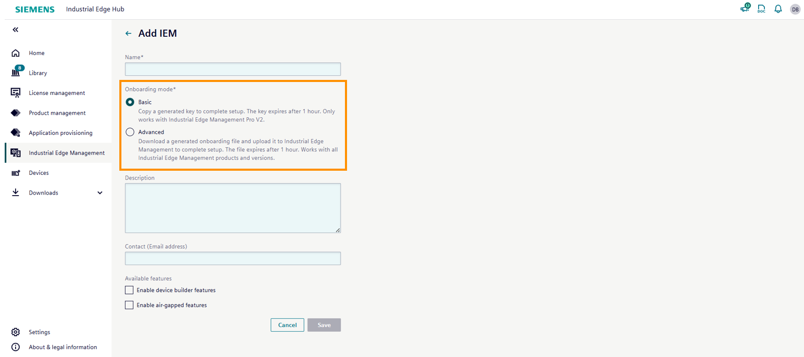
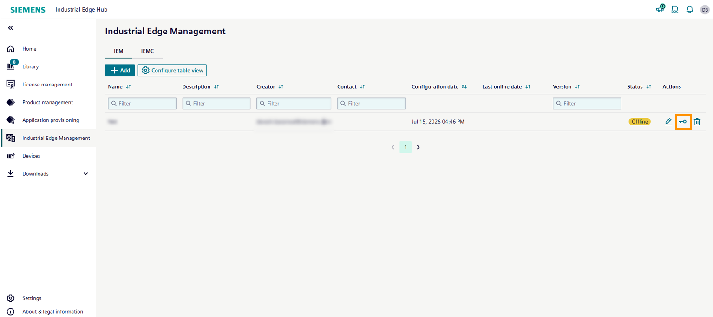
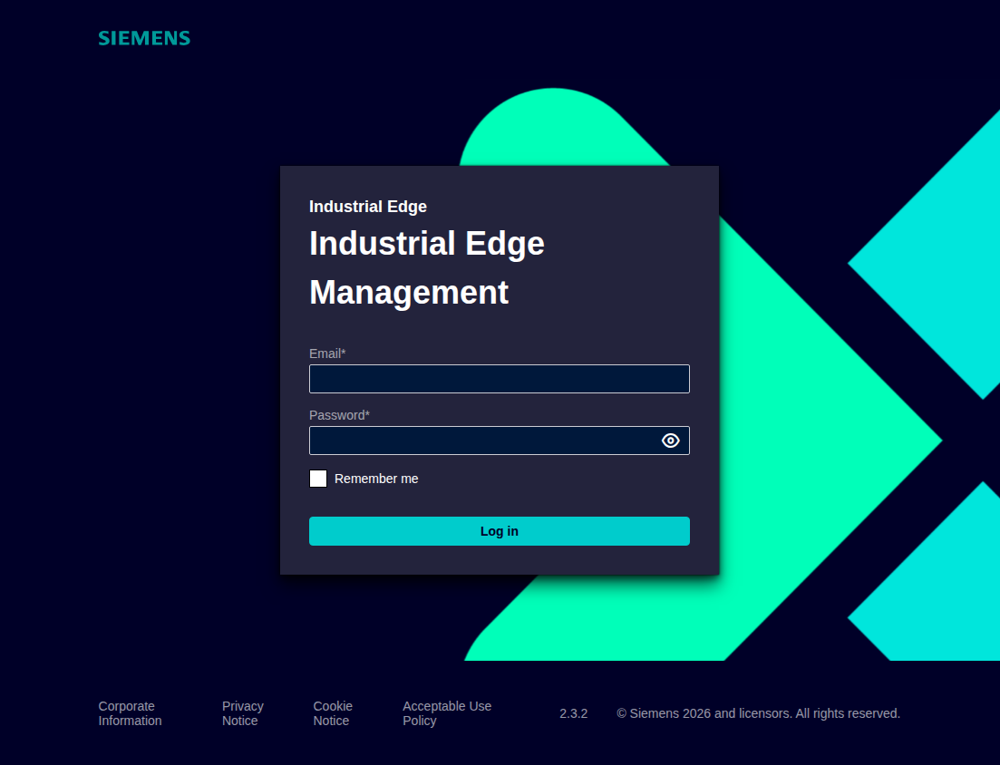

# Deploying Industrial Edge Management on K3s Cluster

To deploy the Industrial Edge Management on a K3s cluster, you must perform the following tasks:

- [Install K3s Cluster](/docs/Installation.md)
- [Create an IEM instance in the Industrial Edge Hub (IEH)](/docs/Deployment.md#create-an-iem-instance-in-the-industrial-edge-hub)
- [Install the IEM on the K3s Cluster](/docs/Deployment.md#install-the-iem-on-the-k3s-cluster)
  
Afterwards, you can:

- [Access the IEM](/docs/Deployment.md#access-the-iem)

## Create an IEM Instance in the Industrial Edge Hub

1. Log into the Industrial Edge Hub.
2. Navigate to `Industrial Edge Management` and click `+Add`.
3. Enter the name, contact email address and, optionally, the description of the IEM instance. Choose the "Basic" onboarding Mode.
   
4. Click `Save`. The IEM instance has been created.
5. Click the key icon to copy the activation key for the newly created IEM instance.
   

> [!IMPORTANT]
> Copy and securely store the activation key, as it will be required during the installation of the IEM on the K3s cluster. The activation key is valid for 1 hour.

## Install the IEM on the K3s cluster

Before proceeding with the installation, ensure that the [general requirements of IEM Pro V2](https://docs.industrial-operations-x.siemens.cloud/r/en-us/v26.09/industrial-edge-platform-operation-setup-operate-utilize/industrial-edge-management/setup-and-operate/iem-pro-v2/introduction/requirements) are satisfied. The following guide describes the minimal installation steps for a fully functional IEM deployment. For detailed information on the installation process and available options, refer to the official [IEM Pro V2 documentation](https://docs.industrial-operations-x.siemens.cloud/r/en-us/v26.09/industrial-edge-platform-operation-setup-operate-utilize/industrial-edge-management/ie-management/ie-management-pro).

### Cluster preparation

Add the public Helm repository for the IEM Pro:

```bash
helm repo add iehub https://repo.portal.eu1.edge.siemens.cloud/public-v2
helm repo update iehub
```

Verify that the repository has been added successfully:

```bash
helm search repo iehub/ie-management
```

Set up a Kubernetes namespace for the IEM Pro deployment. The namespace is used to isolate the IEM Pro resources from other applications running in the cluster.

```bash
export NAMESPACE=iem
kubectl create namespace $NAMESPACE
```

To distinguish the deployment from others, provide a release name.:

```bash
export RELEASE_NAME=myiem
```

To ensure that future IEM Pro upgrades can be applied, allow volume expansion on K3s:

```bash
kubectl patch storageclass local-path -p '{"allowVolumeExpansion": true}'
```

### Create a certificate chain for TLS communication

As part of the IEM, a gateway that serves endpoints for UI or API interaction will be deployed. The gateway can be accessed by a browser or other clients like IE Devices. To secure communication concerning authenticity and integrity, the gateway uses TLS (Transport Layer Security) through certificates. These certificates have to be provided during the installation process. Check out the [IEM Certificate Management](https://docs.industrial-operations-x.siemens.cloud/r/en-us/v26.09/industrial-edge-platform-operation-setup-operate-utilize/industrial-edge-management/utilize/iem-v1/navigation/sign-up-navigation/certificate-management/certificate-management-overview) section for further information.

#### Generation of TLS Certificates

The following example shows how to create certificates for the hostname of the IEM using OpenSSL with some sample data. This includes the creation of a Private Root Certificate, an Intermediate Certificate and Server Certificates for the IEM Pro. The configuration and script files are provided in the `src/certificates/` folder of this example.

1. The hostname of the IEM is a fully qualified domain name (FQDN) that is used to access the IEM. The hostname must be resolvable by the clients that want to access the IEM.

   ```bash
   export HOSTNAME=iem.edge.example.com
   ```

1. Copy the script and configuration files from the `src/certificates/` folder to your working directory.

1. Generate the complete certificate chain for the IEM using the provided script:

   ```bash
   sudo chmod +x gen_with_ca_DNS.sh
   ./gen_with_ca_DNS.sh $HOSTNAME
   ```

1. Create a Kubernetes secret containing the IEM gateway certificates: The TLS secret should contain the private key of the server certificate and server certificate of the IEM, including all intermediate certificates for easier trust management.

   ```bash
   export SECRET_NAME=iemcert
   export PATH_TO_CERT=./out/chain_without_rootCert.crt
   export PATH_TO_KEY=./out/serverCert.key
   
   kubectl create --namespace $NAMESPACE secret tls $SECRET_NAME --cert=$PATH_TO_CERT --key=$PATH_TO_KEY
   ```

### Deploy the IEM on the K3s Cluster

Install the IEM Pro on the K3s cluster with FQDN hostname and the TLS certificates created in the previous step. The `--set` options are used to specify the hostname and the name of the TLS secret created earlier.

Here you need to provide the activation key obtained from the IE Hub when registering the IEM.

```bash
export ACTIVATION_KEY="Place your activation key from the IE Hub here!"
export PATH_TO_CHAIN=./out/rootCert.crt
helm install $RELEASE_NAME iehub/ie-management \
--namespace $NAMESPACE \
--set global.activationKey=$ACTIVATION_KEY \
--set global.hostname=$HOSTNAME \
--set global.storageClassPg="local-path" \
--set global.storageClass="local-path" \
--set global.certChain="$(cat $PATH_TO_CHAIN | base64 -w 0)" \
--set global.gateway.ingress.enabled=false \
--debug \
--timeout 30m0s
```

Depending on the available resources the deployment of the IEM Pro might take up to 30 minutes. Afterward the credentials for two automatically created users are printed to the terminal. Make sure to save these passwords!

> Initial IEM User: **iem_user** - Admin user of the IEM with no access to the Identity and Access Management
>
> Customer Realm Admin: **customer_admin** - Admin user of the IEM with admin access to the Identity and Access Management

### Deploy Ingress of the IEM on the K3s Cluster

The Kubernetes Ingress resource routes external HTTP(S) traffic to the IEM gateway. The gateway handles authentication, session cookies, and JSON web tokens for internal API requests.

Since the default K3s installation includes the Traefik Ingress Controller, a Traefik ingress will be deployed as part of this guide.

1. Copy the `ingress_template.yaml` file from the `src` folder to your working directory.
1. Replace the placeholder-values (written in capital letters) in the `ingress_template.yaml` file with the actual values and write the result to a new file called `ingress.yaml`:

   ```bash
   export GATEWAY_SERVICE=$(kubectl get svc -n $NAMESPACE | grep gateway-proxy | awk '{print $1}')
   
   sed -e "s/HOSTNAME/$HOSTNAME/g" -e "s/GATEWAY_SERVICE/$GATEWAY_SERVICE/g" -e "s/SECRET_NAME/$SECRET_NAME/g" -e "s/NAMESPACE/$NAMESPACE/g" ./ingress_template.yaml > ingress.yaml
   ```

1. Deploy the ingress:

   ```bash
   kubectl apply -f ingress.yaml
   ```

## Access the IEM

You have successfully configured a DNS-based Industrial Edge Management (IEM) system. To access the IEM, the connecting machine must be able to resolve the IEM domain name to its corresponding IP.

In typical scenarios, a private DNS Server with your custom zone and addresses would be employed for all machines that need to access the IEM (Edge Devices, Host & Operator machines).

> If no DNS server is available, a simple approach for this application example would be to edit the `/etc/hosts` file with static address resolution for the IEM system, so it can be accessed directly via the chosen hostname.
>
> To do so, add the following line to the `/etc/hosts` file in a format of `<iem.host.ip>␣<hostname>`, for instance:
>
> ```
> 192.168.1.100 iem.edge.example.com
> ```
>
> **Note**  
> Please ensure that you adjust the IP and domain according to your specific setup.

Next, open your preferred web browser and access the chosen `hostname` address using the HTTPS protocol, for example: `https://iem.edge.example.com`.

You will be prompted to log in to your IEM instance. Use the credentials you received during the installation process.


